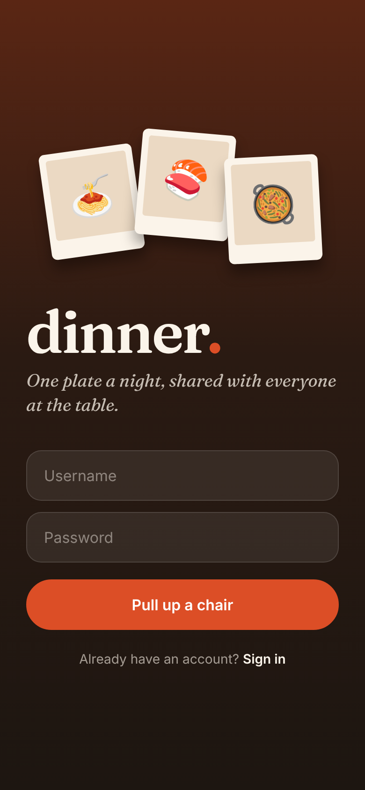
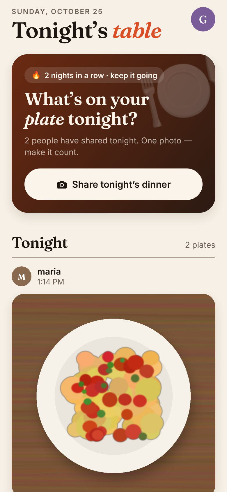
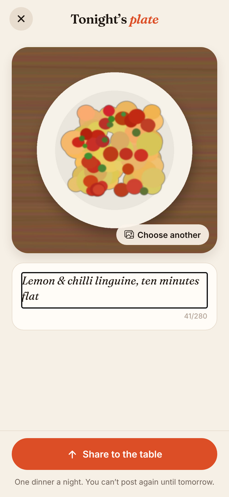
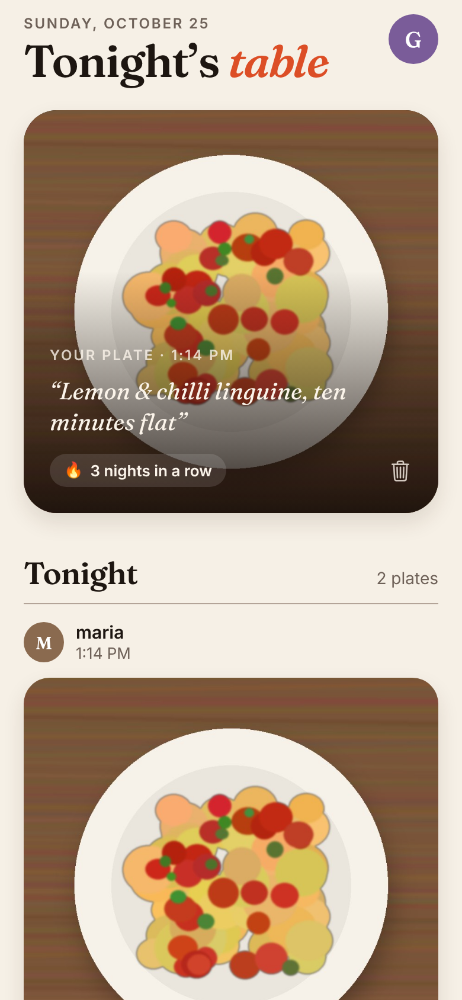

# Dinner 🍽️

A mobile app for sharing a photo of your dinner. Each person gets **one photo per day**.

- `app/`: the mobile app (Expo / React Native, runs on iOS, Android and web)
- `server/`: the API (Node.js + Express + SQLite). It stores users and photos and enforces the daily limit

<p>
  
  
  
  
</p>

## How the one-a-day rule works

Each post is stamped with the calendar day *in the poster's own timezone*, which the app
sends when they sign up. The database has a unique constraint on `(user, day)`, so a
second upload on the same day is rejected with `409`. That means the rule holds even if
someone bypasses the app. Deleting today's photo frees the slot so you can swap a bad
picture.

## Running it locally

Requires Node.js 22.13+.

```bash
# 1. Start the API on port 4000 (data is stored in server/data/)
cd server
npm install
npm start

# 2. In another terminal, start the app
cd app
npm install
npm start
```

Then scan the QR code with the **Expo Go** app on your phone (on the same Wi-Fi as your
computer), or press `w` to open it in a browser. In development the app talks to port
4000 on the computer running `npm start`. To use a deployed server instead, set
`EXPO_PUBLIC_API_URL`, e.g. `EXPO_PUBLIC_API_URL=https://dinner.example.com npm start`.

## API

All endpoints except auth require `Authorization: Bearer <token>`.

| Method | Path             | Description                                                |
| ------ | ---------------- | ---------------------------------------------------------- |
| POST   | `/auth/register` | `{ username, password, timezone }` → `{ token, user }`     |
| POST   | `/auth/login`    | `{ username, password }` → `{ token, user }`               |
| POST   | `/auth/logout`   | Ends the session                                           |
| GET    | `/me`            | Current user, their date today, today's post, streak       |
| GET    | `/posts`         | Everyone's posts, newest first (`?before=<id>` to page)    |
| POST   | `/posts`         | Multipart `photo` (JPEG/PNG/WebP/HEIC, ≤10 MB) + `caption` |
| DELETE | `/posts/:id`     | Delete your own post                                       |

## Checks

```bash
cd server && npm test           # API tests
cd app && npm run typecheck && npm run lint
```

## Before going to production

This is a working MVP. Before a public launch you'd want:

- The server deployed somewhere with persistent disk, or photos moved to S3/R2 and the database to Postgres.
- HTTPS, and app builds made with EAS (`npx eas-cli build`).
- Auth on photo URLs, if that matters to you. Right now they are hard to guess but public.
- Reporting/blocking, rate limiting, and password reset.
